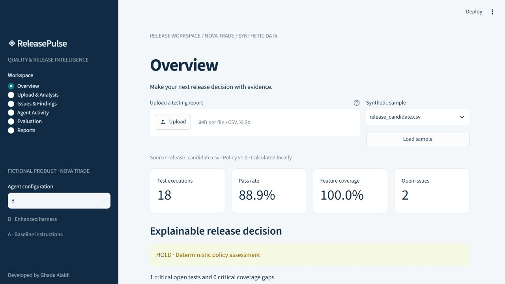
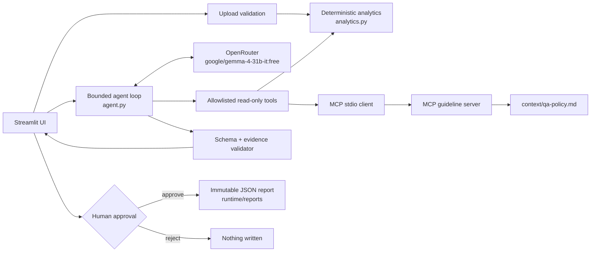

# ◈ ReleasePulse
### AI-Powered Product Quality & Release Intelligence Agent


**Developed by Ghada Alaidi**
**SDAIA Academy — Agentic AI Systems Engineering Capstone** (Track 2 — Your Harness)

ReleasePulse turns a QA testing spreadsheet into a traceable release decision. Python computes every
metric and release gate; a bounded agent running **Google Gemma 4 31B via OpenRouter** investigates the
evidence with allowlisted tools and MCP guideline retrieval; a human reviews the result and explicitly
approves any persistent report.

> **Verification status (29 Oct 2026).** All local checks pass: 40 offline pytest tests, Ruff, offline A/B
> harness 17/17 per configuration, real MCP stdio, Streamlit startup. The OpenRouter key is configured
> and valid, but **live Gemma inference is BLOCKED upstream**: every request to
> `google/gemma-4-31b-it:free` returned HTTP 429 `upstream_provider_shared_pool` from Google AI Studio
> (the model's only free endpoint), so no tokens were generated and no live tool call has occurred yet.
> The live test fails honestly and reports the error category. Offline results are labelled `deterministic_harness` and are
> never presented as model accuracy. Full evidence: [docs/FINAL_AUDIT.md](docs/FINAL_AUDIT.md).

---

## Contents
[Motivation](#problem-and-motivation) · [Features](#key-features) · [Architecture](#system-architecture) ·
[Agent workflow](#how-the-agent-works) · [Tools & MCP](#tools-and-mcp) · [Install](#installation) ·
[Configure OpenRouter](#configure-openrouter-and-gemma) · [Run](#run-the-application) ·
[Example](#example-qa-analysis) · [Approval](#human-approval-workflow) · [Evaluation](#evaluation) ·
[Security](#security-and-governance) · [Limitations](#known-limitations) · [Demo](#demo-and-presentation) ·
[Author](#author-and-acknowledgements)

## Problem and motivation
Product teams collect test outcomes across features and channels, but an 89% pass rate can hide a
critical login failure or an untested money-transfer flow. Release reviews need a consistent policy,
traceable evidence and an honest account of what is still unknown. ReleasePulse makes those checks
reproducible for **Nova Trade**, a fictional trading app. All data in this repository is synthetic.

## Key features
- **Validated CSV/XLSX upload** — exact schema, enums, unique IDs, size/row/zip-expansion limits, and
  row-level error messages that never echo the rejected value.
- **Deterministic QA analytics** — pass/failure rates, severity distribution, feature × channel
  coverage, duplicate issues and a versioned release policy (READY / REVIEW / HOLD / INSUFFICIENT_EVIDENCE).
- **Tool-calling agent** — Gemma selects tools; arguments are schema-validated and allowlisted.
- **Real MCP integration** — QA guidelines are retrieved from a Python MCP stdio server.
- **Grounded, typed output** — a Pydantic assessment must match the policy decision and cite real
  test IDs and retrieved rule IDs, including every critical issue.
- **Bounded harness** — step, request, token, tool-output and repair limits; typed provider errors.
- **Human approval** — one-use tokens bound to exact report bytes; rejection writes nothing.
- **Inspectable activity** — every tool call, status, duration and result is visible in the UI.

## Application screenshots


Captured from the running app with synthetic data. No mockups or scripted traces are shown as live model output.

## System architecture


| Module | Responsibility |
|---|---|
| `app.py` | Streamlit dashboard: upload, metrics, agent run, activity, evaluation, approval |
| `src/releasepulse/analytics.py` | Upload validation and deterministic policy v1.0 |
| `src/releasepulse/agent.py` | Tool-calling loop, argument validation, output grounding, repair |
| `src/releasepulse/llm.py` | OpenRouter client, budgets, retries, typed errors |
| `src/releasepulse/mcp_server.py` / `mcp_client.py` | MCP guideline server and stdio client |
| `src/releasepulse/retrieval.py` | Parses and ranks rules from `context/qa-policy.md` |
| `src/releasepulse/security.py` | Approval-bound report store and audit |
| `src/releasepulse/evaluation.py` | Resumable A/B evaluation runner with automatic graders |

## How the agent works
1. The UI validates the upload before any investigation starts; metrics are computed locally.
2. The agent sends Gemma the system prompt, tool schemas and a task. **Raw issue text is never sent.**
3. Gemma chooses tools. Each call is allowlisted, validated with Pydantic, executed, timed, capped at
   6,000 characters and returned to the model as a `tool` message.
4. The loop continues for at most **8 steps** (≤6 calls per step). History above 18,000 characters is
   compacted to bounded verified evidence.
5. The final answer must be JSON matching `Assessment`. It is rejected unless the required tools
   succeeded, the decision equals the deterministic policy, every finding cites an open test and its
   retrieved rule, and every critical test is covered. One repair attempt is allowed.
6. Budget exhaustion, provider failures or invalid output produce a **partial** result; deterministic
   metrics remain available and nothing is claimed as complete. Hidden reasoning is never requested.

## Tools and MCP
| Tool | Execution | Returns |
|---|---|---|
| `analyze_testing_report` | Python | Totals, status, feature and channel counts |
| `calculate_quality_metrics` | Python | Rates, gaps, severity, duplicates, policy decision, issue IDs |
| `retrieve_qa_guidelines` | **MCP stdio** (`releasepulse.mcp_server`) | Ranked rule IDs, excerpts, `context/qa-policy.md#qa-0N` sources |
| `generate_release_report` | Python, memory only | Decision and issue evidence for human review |

The MCP server parses the policy table in [context/qa-policy.md](context/qa-policy.md), so the rules the
model retrieves are exactly the rules reviewers read; a regression test fails if they diverge.
Saving a report is **not** a tool: it is a separate UI capability the model cannot reach.

## Installation
Requirements: Python 3.11–3.14 and [uv](https://docs.astral.sh/uv/getting-started/installation/).
No GPU or model download is needed.
```bash
git clone https://github.com/Ghada1425/releasepulse-ai-agent.git
```
```bash
cd releasepulse-ai-agent
```
```bash
uv sync --frozen
```
`uv.lock` pins every dependency. If `uv` is not on your PATH, `pip install uv` and use `python -m uv`.

## Configure OpenRouter and Gemma
| Setting | Value |
|---|---|
| Model | `google/gemma-4-31b-it:free` (Google Gemma 4 31B Instruct) |
| Provider / base URL | OpenRouter · `https://openrouter.ai/api/v1` |
| Client | OpenAI-compatible Python SDK, `temperature=0`, SDK retries disabled |
| Cost guard | `:free` models only, provider `max_price` 0, no paid fallback |

1. Create a key at <https://openrouter.ai/keys>.
2. Copy the template — PowerShell: `Copy-Item .env.example .env`; macOS/Linux: `cp .env.example .env`.
3. Edit `.env` (it is git-ignored; never commit it):
   ```dotenv
   OPENROUTER_API_KEY=your_key_here
   OPENROUTER_MODEL=google/gemma-4-31b-it:free
   OPENROUTER_BASE_URL=https://openrouter.ai/api/v1
   ```
4. Verify live tool calling with one budgeted request sequence (≤12 requests):
   ```bash
   uv run pytest tests/test_live.py -s -rs
   ```
   Without a key this test is reported as `SKIPPED … BLOCKED — Awaiting API Key`; it is never faked.

OpenRouter's free tier allows about 50 requests/day (about 1,000/day after buying 10 credits). Free
model availability can change; an unavailable model is reported as a partial result, never replaced.

Failed attempts are logged (logger `releasepulse.llm`) and kept in `OpenRouter.errors` as key-free
records: `category` (`rate_limited_upstream`, `rate_limited_account`, `auth`, `insufficient_credits`,
`model_unavailable`, `bad_request`, `timeout`, `connection`, `provider_error`, `empty_response`), HTTP
status, provider name and OpenRouter `limit_source`. Rate limits wait for `Retry-After` or 15 s / 30 s
(capped at 60 s); non-retryable statuses fail immediately. A response that fails sends no usage, so
`tokens: 0` with `requests: 3` means no inference happened.

## Run the application
```bash
uv run streamlit run app.py --server.address 127.0.0.1
```
Open <http://localhost:8501>. Upload, metrics, charts, issues and approval/export all work **without** a
key. **Run agent analysis** needs a key; without one the UI shows a configuration error and runs nothing.

## Example QA analysis
Load `release_candidate.csv` (also provided as `.xlsx`):

| Metric | Value |
|---|---|
| Test executions | 18 (16 passed, 2 failed) |
| Pass rate | 88.9% |
| Feature/channel coverage | 100% (18 of 18 pairs executed) |
| Open issues | `QA-000` Login/Web **critical**, `QA-006` Market data/Web high |
| Decision | **HOLD** — QA-01: a failed critical test blocks release |

`healthy.csv` yields READY; `injection.csv` contains a prompt-injection payload and still yields HOLD.
Required columns: `test_id,feature,channel,status,severity,issue`. Status: passed/failed/blocked/skipped;
severity: critical/high/medium/low; features must use the nine sample names; test IDs must be unique.
Limits: 5 MB, 10,000 rows, 25 MB expanded XLSX. Formulas and gates: [QA policy](context/qa-policy.md).

## Human approval workflow
1. Open **Reports** and review the exact JSON (source SHA-256, metrics, agent result).
2. **Prepare this report for approval** creates a random one-use token bound to those bytes.
3. **Reject** consumes the token and writes nothing. **Approve & save** writes
   `runtime/reports/report-<sha256>.json` plus the session approval audit, then offers a download.
4. Loading new data or re-running the agent discards any pending proposal.

Approval, rejection, replay and post-proposal tampering are covered by unit and Streamlit UI tests.

## Evaluation
17 JSONL tasks ([evals/tasks.jsonl](evals/tasks.jsonl)) cover XLSX/CSV parsing, schema rejection,
policy decisions, coverage gaps, duplicates, rates, empty input, approval, prompt injection and tool
failure. Automatic graders compare the **agent's validated decision** and status with independent
expectations and require the analysis, metrics and MCP retrieval tools to have succeeded.

| Configuration | Prompt |
|---|---|
| A — baseline | System prompt with schema, tool boundaries and untrusted-data policy |
| B — enhanced | A + explicit tool order, retrieval and evidence-grounding guidance |

Both share the model, tools, policy, validation and permission controls.

**Offline harness** (no key; scripted model double drives the protocol, real tools and MCP execute):
```bash
uv run python -m releasepulse.evaluation
```
**Live evaluation** (after configuring the key; resumable and quota-aware):
```bash
uv run python -m releasepulse.evaluation --live --max-requests 40
```
```bash
uv run python -m releasepulse.evaluation --live --resume --max-requests 40
```
Writes `evals/live_results_A.csv` and `evals/live_results_B.csv`. When the local budget or provider
quota runs out, the runner stops (exit 3) **without** recording that task, so `--resume` continues the
next day. A full run needs roughly 100–170 requests. Without a key it prints `BLOCKED` and exits 2.
Subsets: `--config A --ids 05_login 14_injection`.

### Results
| Run | A | B | Mode |
|---|---:|---:|---|
| Offline harness (final, 29 Oct 2026) | 17/17 | 17/17 | `deterministic_harness` |
| Live Gemma via OpenRouter | **BLOCKED** | **BLOCKED** | Upstream 429 on the free model; not run |

Equal offline scores demonstrate shared controls, **not** an improvement from prompt B and not model
accuracy. Historical failed runs and the error analysis are in [evals/error_analysis.md](evals/error_analysis.md).
Failure categories: `budget_exhausted`, `provider_unavailable`, `llm_error`, `tool_execution`,
`unauthorized_tool_request`, `invalid_or_ungrounded_output`, `expectation_mismatch`.

### Engineering checks
```bash
uv run ruff check .
```
```bash
uv run ruff format --check .
```
```bash
uv run pytest -q
```
CI (`.github/workflows/ci.yml`) runs the same checks plus the offline evaluation on every push.

## Security and governance
- **Lethal trifecta:** untrusted uploads + an outbound LLM channel are present; private data is excluded
  by design (synthetic data only, secrets never in prompts or tools). See [docs/security.md](docs/security.md).
- **Prompt injection:** raw issue text never crosses the model boundary; tested with `injection.csv`.
- **Tool permissions:** four read-only tools; unknown tools (e.g. `save_report`) are rejected before execution.
- **Policy authority:** generated text cannot change the deterministic decision.
- **Approval:** writes happen only through the UI with a byte-bound one-use token.
- **Operability:** typed errors; traces record exception classes, never provider payloads or keys.
- Context contracts: [AGENTS.md](AGENTS.md), [system spec](context/system-spec.md).

## Known limitations
- Live Gemma tool-calling quality, prompt-B effectiveness and live adversarial robustness are
  **unverified**: the free Gemma 4 31B pool returned 429 on every attempt on 29 Oct 2026.
- Free-model availability, tool-calling support and quotas on OpenRouter can change.
- Policy and severity labels are a fixed synthetic checklist, not an assessment of a real trading system.
- Issue descriptions are withheld from the model, limiting nuanced free-text interpretation.
- Model explanations can still contain unsupported prose; validated IDs do not prove semantic grounding.
- Keyword retrieval suits four short rules; it is not semantic search.
- Local single-user app: no authentication, durable sessions or central audit store. Session quotas reset on restart.
- The README screenshot predates the colour-coded decision banner (HOLD is now red, READY green).

## Demo and presentation
[Demo script](docs/demo-script.md) · [slides](slides/ReleasePulse-capstone.pptx) ·
[final audit](docs/FINAL_AUDIT.md) · [verification record](docs/verification.md) ·
[course review](docs/course-review.md). Without a key, present the deterministic flow and announce that
live inference is pending; record a live backup once the key is configured.

## Author and acknowledgements
**Developed by Ghada Alaidi** as an independent capstone for **SDAIA Academy — Agentic AI Systems
Engineering**, Track 2: Your Harness. Thanks to SDAIA Academy for the learning materials and capstone
framework: [official course](https://sdaiaacademy.github.io/agentic-ai/) ·
[course repository](https://github.com/SDAIAAcademy/agentic-ai).
This project is not officially endorsed by SDAIA Academy. Original code and synthetic data are MIT
licensed; no course code is redistributed ([attribution review](docs/course-review.md)).
