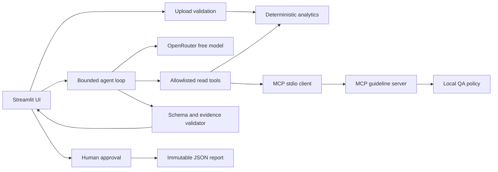

# ◈ ReleasePulse
### AI-Powered Product Quality & Release Intelligence Agent


**Developed by Ghada Alaidi**  
**Academic Capstone Project — SDAIA Academy**  
**Program: Agentic AI Systems Engineering**

ReleasePulse turns synthetic QA spreadsheets into a traceable release decision. Python computes the
metrics and release gates; a bounded agent investigates evidence with local tools and MCP retrieval.
The user reviews the result and explicitly approves any persistent report export.

> **Verification status:** local tool, harness and UI tests are supplied. Live OpenRouter inference and
> live A/B evaluation remain pending an API key. Published at [Ghada1425/releasepulse-ai-agent](https://github.com/Ghada1425/releasepulse-ai-agent).
> Offline results are explicitly labelled `deterministic_harness`, never presented as model accuracy.

## Problem and motivation
Product teams collect test outcomes across features and channels, but raw pass rates can hide a critical
login failure or an untested transfer flow. Release reviews need consistent policy, evidence and a clear
account of what remains unknown. ReleasePulse makes those checks reproducible for fictional Nova Trade.

## Proposed solution and key features
- Validated CSV/XLSX input, synthetic samples, real metrics and coverage analysis.
- Four functional tools, including guideline retrieval through a real MCP stdio server/client.
- Configurable Gemma via OpenRouter, real model-selected function calls and typed final output.
- Explainable release policy with test IDs, guideline IDs and remediation suggestions.
- Bounded steps, requests, context, tool outputs, retries and token reservations.
- One-use approval tokens bound to immutable report bytes; rejected reports never save.
- Inspectable tool activity, actual evaluation CSVs and security regression tests.

## Application screenshots


Captured from the running app with synthetic data. No generated mockups or scripted-agent traces
are presented as live model screenshots.

## System architecture


## How the agent works
The UI validates the report before an investigation starts. The model selects tools and arguments.
Each call is schema-validated and allowlisted, executed, timed and returned as bounded evidence.
The model can iterate for eight steps. A final Pydantic assessment must match the Python policy decision,
cite real issue IDs and retrieved rules, and include every critical issue. Invalid output gets one repair
opportunity. Exhaustion or failure returns safe partial results with deterministic metrics.
No hidden chain-of-thought is requested or displayed.

## Technology and tools
Python 3.11–3.14, Streamlit, Pandas, OpenPyXL, Pydantic, OpenAI-compatible SDK, MCP Python SDK v1,
pytest, Ruff and uv. MCP v1 is deliberately pinned; course examples use a newer API, so this integration
is implemented against the installed SDK and verified by a subprocess integration test.

| Tool | Execution | Evidence |
|---|---|---|
| analyze_testing_report | Python | Totals, statuses, feature/channel counts |
| calculate_quality_metrics | Python | Rates, gaps, severity, duplicates, policy decision |
| retrieve_qa_guidelines | MCP stdio | Ranked policy IDs and excerpts |
| generate_release_report | Python, memory only | Decision and issue evidence ready for review |

Persistent saving is a separate UI capability, unavailable to the model.

## Installation requirements
Install Python 3.11+ and [uv](https://docs.astral.sh/uv/getting-started/installation/).
From the repository root:
```bash
uv sync --frozen
```
The committed `uv.lock` pins dependencies. No model downloads or GPU are required.

## Environment configuration
Copy `.env.example` to `.env` (`Copy-Item .env.example .env` in PowerShell; `cp .env.example .env` on Unix).
Set the key locally; never commit it:
```dotenv
OPENROUTER_API_KEY=your_key_here
OPENROUTER_MODEL=google/gemma-4-31b-it:free
OPENROUTER_BASE_URL=https://openrouter.ai/api/v1
```
The model ID was found in OpenRouter's public catalog on 29 October 2026 with zero token pricing.
This verifies availability metadata, not successful inference. Availability and quotas can change.
Only free model IDs and zero-price providers are allowed; no automatic paid fallback.

## Run locally
```bash
uv run streamlit run app.py --server.address 127.0.0.1
```
Open http://localhost:8501. Deterministic upload, charts and approval/export work without a key.
The **Run agent analysis** button requires a real key and never substitutes a scripted response.

## Example workflow
1. Load `release_candidate.csv`: 18 executions, 16 passed, two failed, 100% feature/channel execution.
2. Observe HOLD: QA-000 is a critical Login/Web failure. A high-priority market-data failure also needs review.
3. Run the agent and inspect actual tools and retrieved excerpts in Agent Activity.
4. Review the AI findings alongside deterministic evidence.
5. In Reports, prepare the preview; reject once to demonstrate no write.
6. Prepare again, approve and download the exact JSON report.

All samples are fictional. Required columns: `test_id,feature,channel,status,severity,issue`.
Use the exact sample feature names. Status values: passed/failed/blocked/skipped; severity:
critical/high/medium/low. Test IDs must be unique. Limits: 5 MB, 10,000 rows, 25 MB expanded XLSX.
The complete formulas and release gates are in [QA policy](context/qa-policy.md).

## Evaluation methodology
```bash
uv run pytest -q
uv run ruff check .
uv run ruff format --check .
uv run python -m releasepulse.evaluation
```
Seventeen JSONL cases have independently specified expected decisions, metrics, rejections or permissions.
Both A and B run the same tasks and core controls. A has basic instructions; B adds tool order and grounding
guidance. Offline runs use an explicitly named `ScriptedLLM` protocol double but execute real tools/MCP.
They test engineering invariants, not the model's ability to choose tools or reason.

Live evaluation, after configuring credentials:
```bash
uv run python -m releasepulse.evaluation --live --max-requests 40
```
Output: `evals/live_results_A.csv` and `live_results_B.csv`. Forty attempts may not finish 34 cases;
budget exhaustion is recorded as failure/partial, never a fabricated success. For quota-friendly subsets:
```bash
uv run python -m releasepulse.evaluation --live --config A B --ids 05_login 14_injection --max-requests 30
```
Each command replaces its selected result files; archive prior runs before comparing trials. Each CSV records
task, input, expectation, actual result, tool calls, pass/failure, category, time and cumulative usage.
Validation/approval cases are local checks even in live mode. A complete live comparison requires enough
provider quota and separately reviewed model explanations.

## Actual A/B results and error analysis
Measured local results are in [A](evals/results_A.csv), [B](evals/results_B.csv) and
[error analysis](evals/error_analysis.md). Live model success rates are **not available**.
Equal offline pass rates demonstrate shared controls; they do not establish an improvement from prompt B.

| Verification | Result |
|---|---|
| Pytest regression suite | 22 passed |
| Offline harness A | 17/17 passed |
| Offline harness B | 17/17 passed |
| Live model A/B | Pending credentials |

## Security and governance
Read the [attack and defence note](docs/security.md), [context specification](context/system-spec.md)
and [engineering contract](AGENTS.md). Raw issue text is excluded from model input, tools are read-only,
API destinations are fixed, and policy decisions cannot be overridden by generated text.
Report export requires human approval of exact content. Session audit records approval and rejection;
only approved reports persist their audit. Logs omit raw provider errors and credentials.

## Limitations
- Live inference, live prompt effectiveness and live adversarial-model behavior are unverified until credentials are supplied.
- A fixed synthetic checklist and severity labels are assumptions, not an assessment of an actual trading system.
- Free-text issue descriptions are withheld from the model; nuanced issue interpretation is limited.
- Model explanations may still contain unsupported prose despite valid evidence references; human review is required.
- Keyword retrieval is appropriate for four short rules; it is not semantic search.
- Session quotas reset on restart; account-level quotas remain the provider's responsibility.
- Local single-user deployment only; no authentication, durable sessions or centralized audit service.

## Future improvements
Run paired live trials and examine incorrect reasoning, extend policy fixtures, add consented durable
audits, evaluate controlled extraction of issue text, and add authenticated deployment only if needed.

## Demo, presentation and reproducibility
See [demo script](docs/demo-script.md), `slides/`, [verification record](docs/verification.md) and
[course review](docs/course-review.md). No backup live-model recording is claimed.

## GitHub publication
After re-authenticating, from this repository:
```bash
gh auth login --hostname github.com
git status
gh repo create releasepulse-ai-agent --public --source=. --remote=origin --push
gh repo view --json url
git ls-remote origin HEAD
```
If the name already exists, inspect that repository before adding a remote; do not overwrite it.

## Author and acknowledgements
**Developed by Ghada Alaidi.** Independent academic capstone for **SDAIA Academy — Agentic AI Systems
Engineering**, Track 2: Your Harness. Thank you to SDAIA Academy for the learning materials and capstone
framework: [official course](https://sdaiaacademy.github.io/agentic-ai/) and
[course repository](https://github.com/SDAIAAcademy/agentic-ai).
This project is not officially endorsed by SDAIA Academy. Original code and synthetic datasets are MIT
licensed; no unlicensed course code is redistributed. See [attribution review](docs/course-review.md).
